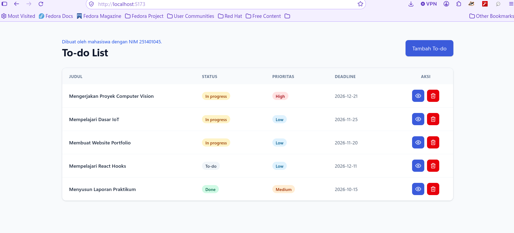
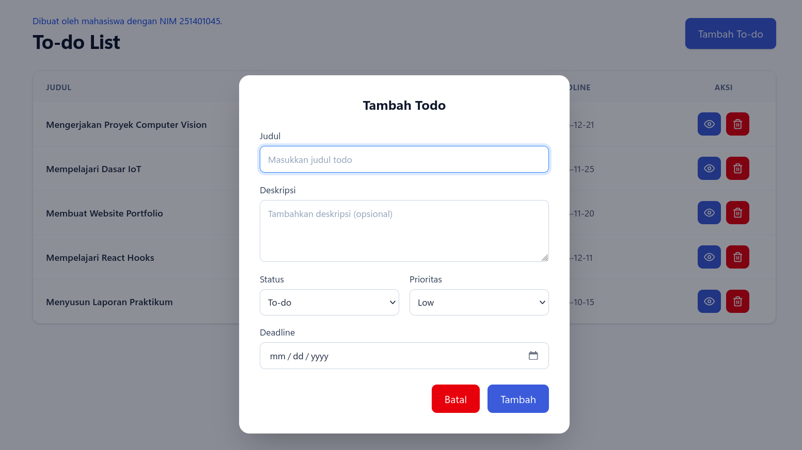
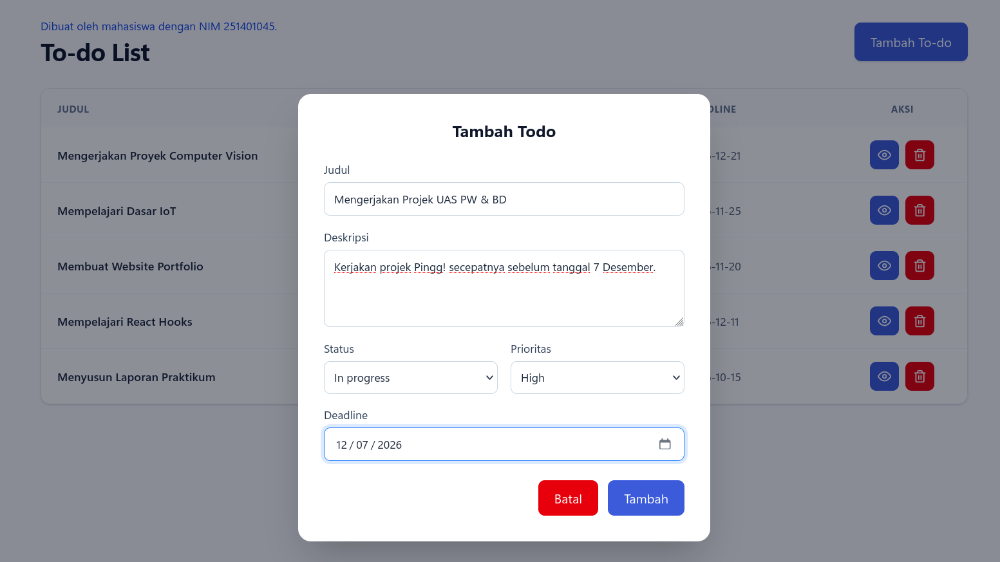
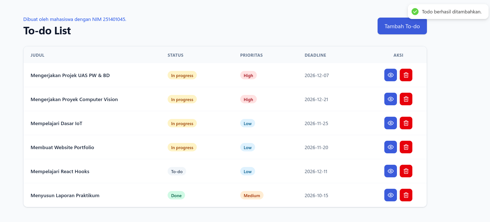
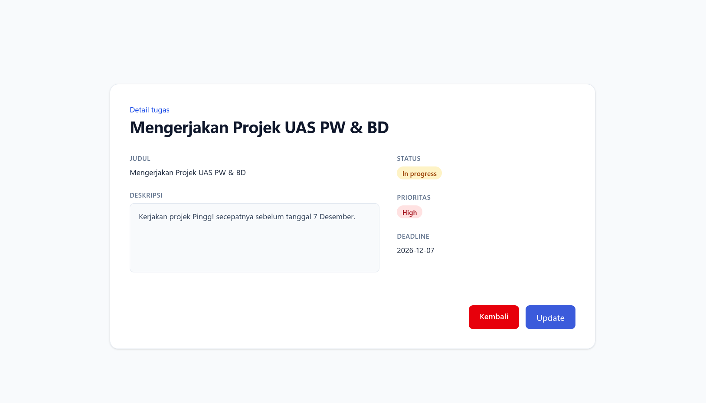
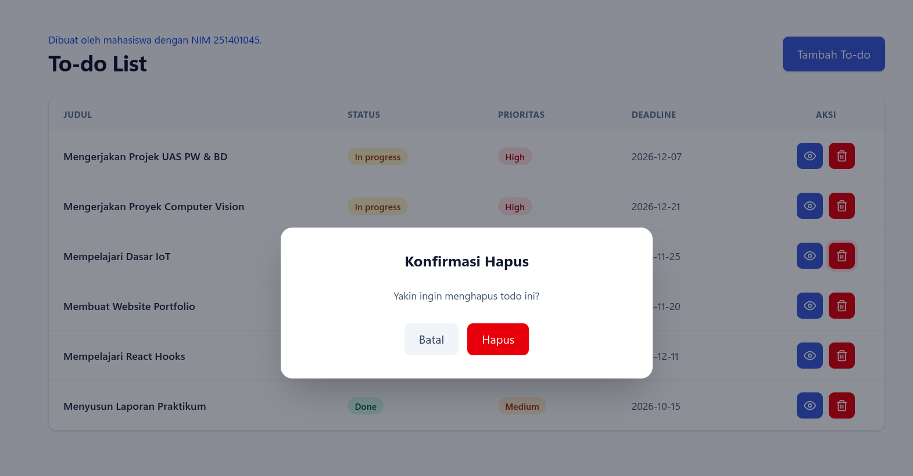
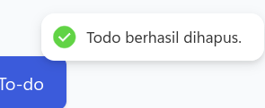
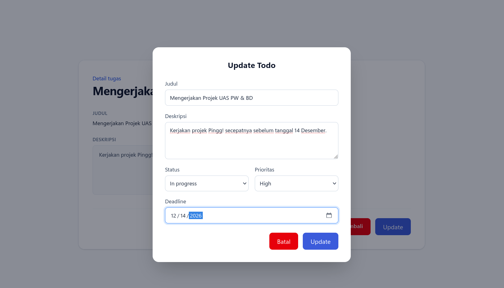
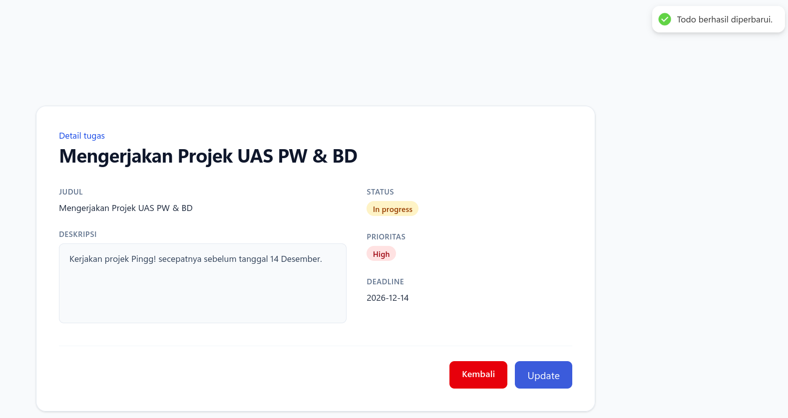
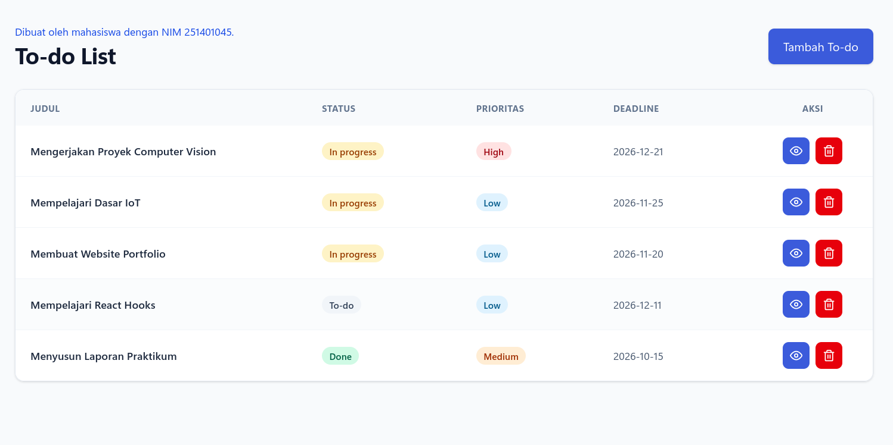

# Todo List

Aplikasi To-Do List frontend menggunakan React dan Vite. Data tugas menggunakan data dummy di memori browser; aplikasi ini tidak menggunakan backend atau REST API dan perubahan tidak tersimpan setelah halaman dimuat ulang.

## Cara Menjalankan

1. Pastikan Node.js dan npm sudah terpasang.
2. Buka terminal di folder proyek.
3. Jalankan `npm install`.
4. Jalankan `npm run dev`, lalu buka alamat lokal yang ditampilkan Vite.

Untuk membuat build produksi, jalankan `npm run build`.

## Fitur

- Melihat daftar todo dengan status, prioritas, dan deadline.
- Menambahkan todo dengan validasi judul dan deadline.
- Melihat detail dan memperbarui todo.
- Menghapus todo dengan dialog konfirmasi.
- Navigasi halaman dengan React Router.
- Notifikasi tindakan dan tampilan responsif.

## Screenshot

